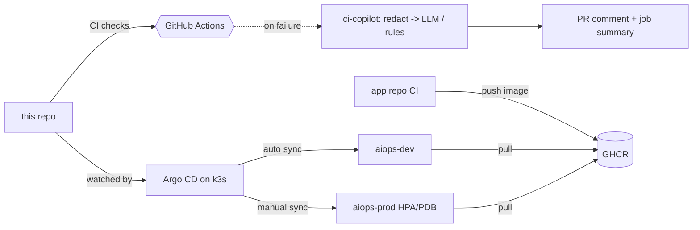
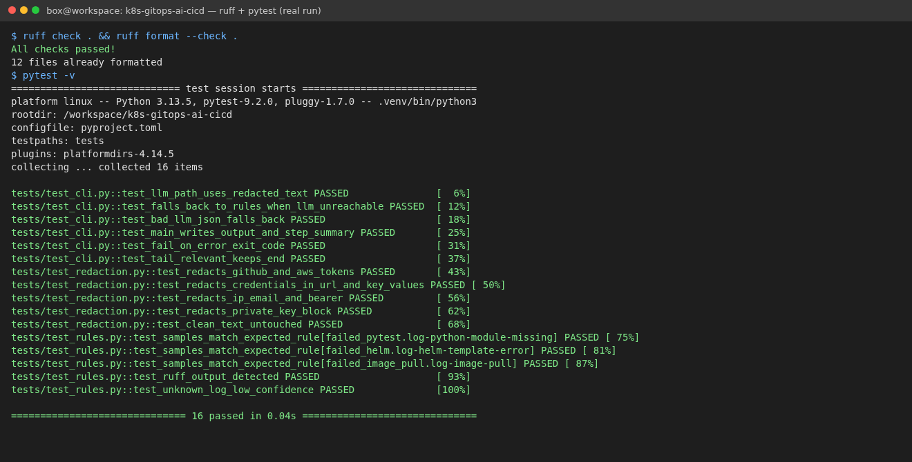
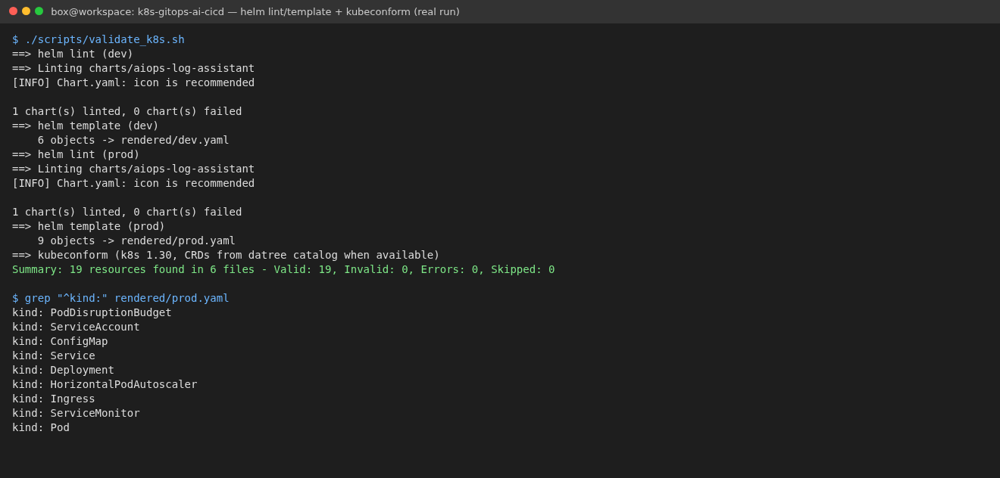
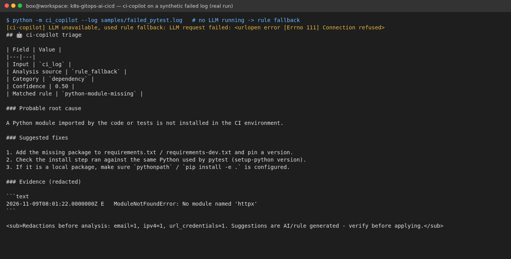
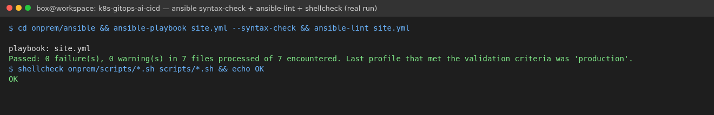

# k8s-gitops-ai-cicd (Learning Reference)

On-prem **Kubernetes (k3s)** + **Helm** + **GitOps with Argo CD** for the sibling
[`aiops-log-assistant`](https://github.com/Woo404/aiops-log-assistant) service, plus
**ci-copilot** - a small AI-assisted CI tool that explains failed CI runs using an
OpenAI-compatible LLM (Ollama by default), with secret redaction and a rule-based fallback.

> **Learning / portfolio project.** It was built to practise the topics below on a home lab.
> There are no production users and no production metrics here. Run it yourself, change it,
> and only claim what you have actually done.

Sibling projects:
[aiops-log-assistant](https://github.com/Woo404/aiops-log-assistant) (the app) ·
[cloud-ansible-aiops](https://github.com/Woo404/cloud-ansible-aiops) (VM delivery on Aliyun ECS / AWS EC2 with Ansible + Terraform).

| Topic | Where |
|-------|-------|
| On-prem Kubernetes (k3s), Ansible roles | `onprem/ansible`, `onprem/scripts/install_k3s_single_node.sh` |
| Helm chart: probes, resources, HPA, PDB, Ingress, optional ServiceMonitor | `charts/aiops-log-assistant` |
| GitOps: Argo CD AppProject, app-of-apps, dev (auto-sync) / prod (manual sync) | `argocd/`, `environments/` |
| CI/CD: ruff, pytest, helm lint/template, kubeconform, ansible-lint, shellcheck | `.github/workflows/ci.yml` |
| AI-assisted dev tool: failed-log / diff triage, PR comment | `ci_copilot/`, `action.yml`, `.github/workflows/ci-copilot-example.yml` |

## Architecture



More detail and the promotion flow: [docs/architecture.md](docs/architecture.md).

## Quick start

### 1. ci-copilot (any laptop, no cluster needed)

```bash
python3 -m venv .venv && source .venv/bin/activate
pip install -r requirements-dev.txt
ruff check . && pytest -q

# rules only
python -m ci_copilot --log samples/failed_pytest.log --no-llm

# with a local LLM
ollama pull qwen2.5:7b
export CI_COPILOT_LLM_BASE_URL=http://localhost:11434/v1 CI_COPILOT_LLM_MODEL=qwen2.5:7b
python -m ci_copilot --log samples/failed_helm.log --output report.md
git diff HEAD~1 | python -m ci_copilot --diff -
```

| Env var | Default | Meaning |
|---------|---------|---------|
| `CI_COPILOT_LLM_BASE_URL` | `http://localhost:11434/v1` | Any OpenAI-compatible endpoint |
| `CI_COPILOT_LLM_MODEL` | `qwen2.5:7b` | Model name |
| `CI_COPILOT_LLM_API_KEY` | `ollama` | Pass from a secret store |
| `CI_COPILOT_LLM_TIMEOUT` | `60` | Seconds |
| `CI_COPILOT_DISABLE_LLM` | unset | `true` = rules only |

The CLI is **stdlib-only** so the GitHub Action needs no `pip install`.

### 2. Validate the Kubernetes side locally

```bash
# needs helm 3 and kubeconform on PATH
./scripts/validate_k8s.sh
```

### 3. On-prem cluster

Single VM (Ubuntu 22.04/24.04, 2 vCPU / 4 GB is enough for k3s + Argo CD; Ollama needs more):

```bash
sudo ./onprem/scripts/install_k3s_single_node.sh
```

Multi-node with Ansible:

```bash
cd onprem/ansible
cp inventory.example.ini inventory.ini        # your node IPs
ansible-galaxy collection install -r requirements.yml
ansible-playbook site.yml
export KUBECONFIG=$PWD/kubeconfig && kubectl get nodes
```

### 4. GitOps

`site.yml` / the install script apply `argocd/project.yaml` and `argocd/root-app.yaml`.
Argo CD then creates `aiops-dev` (auto-sync, self-heal) and `aiops-prod` (manual sync).

```bash
kubectl -n argocd port-forward svc/argocd-server 8080:443
# prod needs an LLM key secret even if it is a dummy for Ollama:
kubectl create ns aiops-prod
kubectl -n aiops-prod create secret generic aiops-llm-secret --from-literal=LLM_API_KEY=ollama
```

Promote by PR: change `environments/prod/values.yaml` `image.tag` to a `sha-xxxxxxx` tag that
exists in GHCR. Roll back with `git revert`. If the GHCR package is private, add an
`imagePullSecrets` entry.

### 5. ci-copilot in GitHub Actions

See `.github/workflows/ci-copilot-example.yml`: tests run with output captured to `test.log`;
only on failure the local Action (`uses: ./`) triages it and the report is posted as a PR comment.
Set the repo secret `CI_COPILOT_LLM_BASE_URL` to a self-hosted LLM the runner can reach;
without it the Action runs in rules-only mode and nothing leaves the runner.

## Screenshots (real terminal output from running this repo)

**ruff + pytest (16 passed)**


**helm lint / template + kubeconform (19 resources valid)**


**ci-copilot on a synthetic failed log, no LLM running -> rule fallback**


**ansible syntax-check + ansible-lint (production profile) + shellcheck**


Not shown yet (add your own after you run them): `kubectl get pods` on your k3s cluster,
Argo CD UI with dev Synced/Healthy, a PR comment from ci-copilot, an LLM-backed triage result.

## Design decisions

| Decision | Why |
|----------|-----|
| k3s | Small CNCF-conformant distro, good for on-prem / edge / home lab; ships Traefik + local-path storage |
| Helm + per-env values files | One chart, differences reviewed as small diffs |
| Argo CD app-of-apps | Cluster state = Git; drift self-heals in dev |
| prod = manual sync | Change control: a human approves what Argo CD shows as the diff |
| Immutable image tags in prod | `latest` is not reproducible; rollback = revert a tag bump |
| ci-copilot redacts before any LLM call | CI logs leak tokens/URLs; least data leaves the trust boundary |
| Rule fallback + explicit `analysis_source` | CI tooling must not depend on an LLM being up, and must not pretend |
| Advisory only | Suggestions are posted; nothing is auto-applied or auto-merged |

## Limitations / next steps

- Rules are a small, hand-written set; an evaluation set of labelled CI failures would measure usefulness
- No Sealed Secrets / External Secrets yet (secrets are created by hand)
- Image tag bump is manual; Argo CD Image Updater or a Renovate rule could open the PR
- No network policies; no multi-cluster
- ServiceMonitor needs kube-prometheus-stack installed in the cluster

## License

MIT
