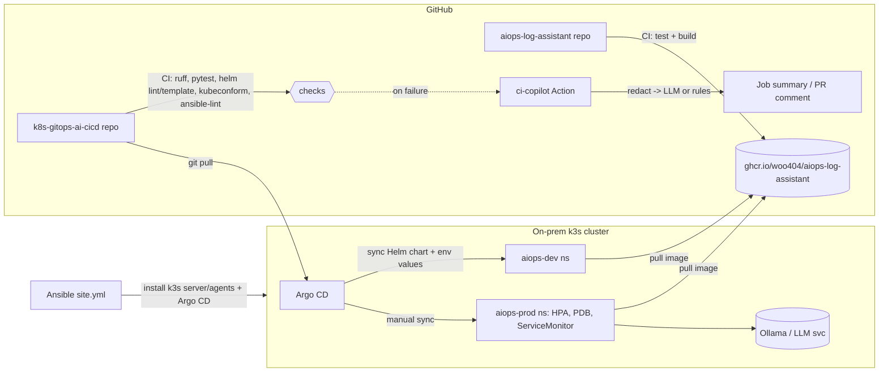

# Architecture



## Promotion flow (GitOps)

1. App repo CI pushes `ghcr.io/woo404/aiops-log-assistant:sha-<short>`.
2. Open a PR in this repo that changes `environments/dev/values.yaml` (or relies on `latest` for dev).
3. CI validates the chart; if anything fails, ci-copilot posts a triage comment.
4. Merge -> Argo CD auto-syncs **dev**.
5. After checking dev, open a PR bumping `environments/prod/values.yaml` `image.tag`.
6. Merge -> Argo CD shows **prod** OutOfSync; a human reviews the diff and syncs.
7. Rollback = `git revert` the bump PR (or `argocd app rollback aiops-prod`).

## ci-copilot data flow

```text
failed step log / git diff
   -> redact (tokens, keys, URL creds, passwords, emails, IPv4, private keys)
   -> keep last ~12k chars (errors live near the end)
   -> OpenAI-compatible /chat/completions (Ollama by default), JSON-only prompt
        | unreachable / bad JSON
        v
      rule engine (9 rules: deps, pytest, ruff, helm, schema, image pull, docker, network, perms)
   -> Markdown -> $GITHUB_STEP_SUMMARY + file for PR comment
```
